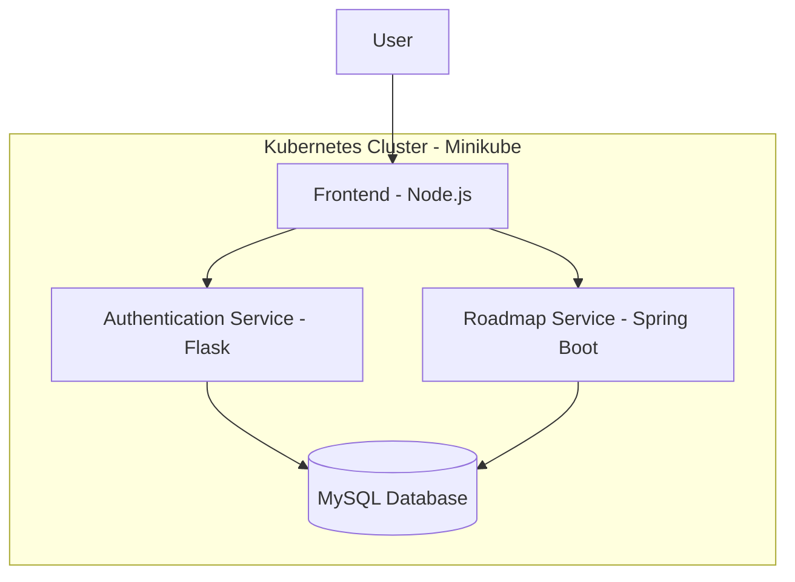
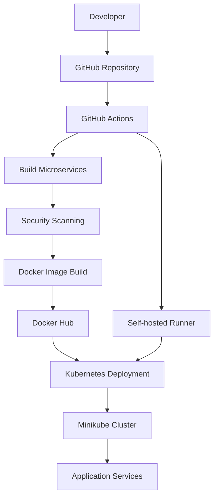

# Setup Instructions and Architecture Overview

## 1. Project Overview

The iVolve Cloud DevOps Project demonstrates the deployment and automation of a microservices-based application using modern DevOps tools.

The project integrates containerization, Infrastructure as Code, CI/CD automation, security scanning, and Kubernetes orchestration.

The application consists of four main components:

- Frontend
- Authentication Service
- Roadmap Service
- MySQL Database

---

# Part 1: Setup Instructions

## 2. Prerequisites

The following tools are required to work with the project:

| Tool | Purpose |
|------|---------|
| Git | Source code management |
| Docker | Containerization |
| kubectl | Kubernetes management |
| Minikube | Local Kubernetes cluster |
| Terraform | Infrastructure as Code |
| GitHub Account | Source code and CI/CD |
| Docker Hub Account | Container image registry |

Ubuntu Linux running under WSL2 can be used as the development environment.

## 3. Clone the Repository

Clone the project repository:

```bash
git clone https://github.com/samaalaa785-dev/CloudDevOpsProject.git

cd CloudDevOpsProject
```

## 4. Start the Kubernetes Environment

Start Minikube using Docker as the driver:

```bash
minikube start --driver=docker
```

Verify the cluster:

```bash
minikube status
kubectl cluster-info
kubectl get nodes
```

Make sure the Kubernetes node is Ready before continuing.

## 5. Prepare Kubernetes Configuration

The Kubernetes configuration files are stored in the `Kubernetes/` directory.

They include:

- Namespace configuration
- ConfigMap
- Frontend Deployment and Service
- Authentication Deployment and Service
- Roadmap Deployment and Service
- MySQL StatefulSet and Service
- StorageClass configuration
- Ingress configuration

The application uses the `ivolve` namespace.

Before deployment, make sure the required Kubernetes Secret named `ivolve-secret` is configured in the namespace.

The Secret contains application configuration and sensitive values. Do not commit real credentials to GitHub.

Check whether the Secret exists:

```bash
kubectl get secret ivolve-secret -n ivolve
```

If setting up a fresh environment, create the Secret using the exact key names referenced by the application manifests and your own credentials.

## 6. Deploy the Application

Apply the Kubernetes manifests:

```bash
kubectl apply -f Kubernetes/
```

Check the deployed resources:

```bash
kubectl get all -n ivolve
kubectl get pods -n ivolve
kubectl get services -n ivolve
kubectl get pvc -n ivolve
```

Wait until the application pods reach the Running state.

## 7. Access the Frontend

The frontend Service is configured to expose port 3000 internally and NodePort 30081.

A local port-forward can be used to access the frontend:

```bash
kubectl port-forward svc/frontend 3002:3000 -n ivolve
```

Open the following address in a browser:

http://localhost:3002

Verify the HTTP response from another terminal:

```bash
curl -I http://localhost:3002
```

An HTTP 200 response indicates that the frontend is responding successfully.

## 8. Verify the Deployment

Use the following commands to inspect the application:

```bash
kubectl get pods -n ivolve

kubectl get deployments -n ivolve

kubectl get services -n ivolve

kubectl get statefulsets -n ivolve

kubectl get ingress -n ivolve

kubectl get pvc -n ivolve
```

Check pod logs when troubleshooting:

```bash
kubectl logs -n ivolve <pod-name>
```

Describe a pod to investigate deployment issues:

```bash
kubectl describe pod <pod-name> -n ivolve
```

## 9. CI/CD Setup

GitHub Actions is used to automate the application delivery workflow.

The project includes automated workflows for:

1. Building application microservices.
2. Running security checks.
3. Building Docker images.
4. Publishing images to Docker Hub.
5. Deploying the application to Kubernetes.

A self-hosted GitHub Actions Runner is used to connect the deployment workflow to the local Minikube environment.

Required repository secrets and variables must be configured in GitHub before running workflows.

Sensitive credentials must never be stored directly in workflow files.

---

# Part 2: Architecture Overview

## 10. Application Architecture

The application follows a microservices architecture.

Each service is containerized independently and deployed as a Kubernetes workload.

### Application Components

| Component | Technology | Port |
|-----------|------------|------|
| Frontend | Node.js | 3000 |
| Authentication Service | Python Flask | 5000 |
| Roadmap Service | Java Spring Boot | 8080 |
| Database | MySQL 8.4 | 3306 |

### Container Images

The application images are published to Docker Hub:

- Frontend: `sama2alaa/ivolve-frontend:latest`
- Authentication: `sama2alaa/ivolve-auth:latest`
- Roadmap: `sama2alaa/ivolve-roadmap:latest`

## 11. High-Level Architecture



The frontend provides the application interface.

The authentication service handles authentication-related operations, while the roadmap service handles roadmap-related operations.

MySQL provides persistent data storage.

## 12. DevOps Architecture



### Main DevOps Components

**GitHub and Git**

Used for source code management and collaboration.

**GitHub Actions**

Automates build, security scanning, image publishing, and deployment workflows.

**Docker**

Packages each application component into a container image.

**Docker Hub**

Stores the published application images.

**Gitleaks**

Checks for exposed secrets and credentials.

**Trivy**

Scans container images for security vulnerabilities.

**Terraform**

Provides reusable Infrastructure as Code modules for infrastructure configuration.

**Minikube and Kubernetes**

Provide the local Kubernetes environment and application orchestration.

**Self-hosted Runner**

Connects GitHub Actions deployment workflows with the local Kubernetes cluster.

## 13. Kubernetes Resources

The Kubernetes configuration is organized under the `Kubernetes/` directory.

The main resources include:

| Resource | Responsibility |
|----------|----------------|
| Namespace | Isolates application resources |
| ConfigMap | Stores non-sensitive configuration |
| Secret | Stores sensitive configuration |
| Deployments | Manage application pods |
| Services | Provide stable network access |
| StatefulSet | Manages MySQL |
| PersistentVolumeClaim | Requests persistent storage |
| StorageClass | Defines storage provisioning |
| Ingress | Provides HTTP routing |

The frontend uses NodePort 30081, while internal services communicate through Kubernetes Services.

MySQL uses persistent storage through a PersistentVolumeClaim.

## 14. Infrastructure as Code

Terraform is used to organize infrastructure configuration into reusable modules.

The project includes infrastructure modules related to:

- Networking
- Amazon ECR
- Amazon EKS

Terraform configuration validation helps verify the infrastructure code.

The documented Kubernetes deployment uses Minikube locally; Terraform validation does not mean that AWS resources have been provisioned.

## 15. Security and Best Practices

The project incorporates the following security practices:

- Secret detection using Gitleaks.
- Container vulnerability scanning using Trivy.
- Sensitive configuration stored in Kubernetes Secrets and GitHub repository secrets.
- Independent container images for application services.
- Kubernetes namespace isolation.
- Persistent storage for the database.

Real credentials should not be committed to the repository.

## 16. Troubleshooting

### Check Minikube

```bash
minikube status
```

### Check Kubernetes Pods

```bash
kubectl get pods -n ivolve
```

### Check Application Logs

```bash
kubectl logs -n ivolve <pod-name>
```

### Check Services

```bash
kubectl get svc -n ivolve
```

### Check Storage

```bash
kubectl get pvc -n ivolve
```

### Check GitHub Actions

Open the repository on GitHub and navigate to the Actions tab to inspect workflow execution results.

---

## 17. Conclusion

This documentation provides the setup procedure, application architecture, infrastructure overview, and deployment workflow of the iVolve Cloud DevOps Project.

It describes how application services are containerized, security checks are integrated into CI/CD, and Kubernetes is used to orchestrate the application.

The architecture demonstrates an automated application delivery workflow using modern DevOps technologies.
